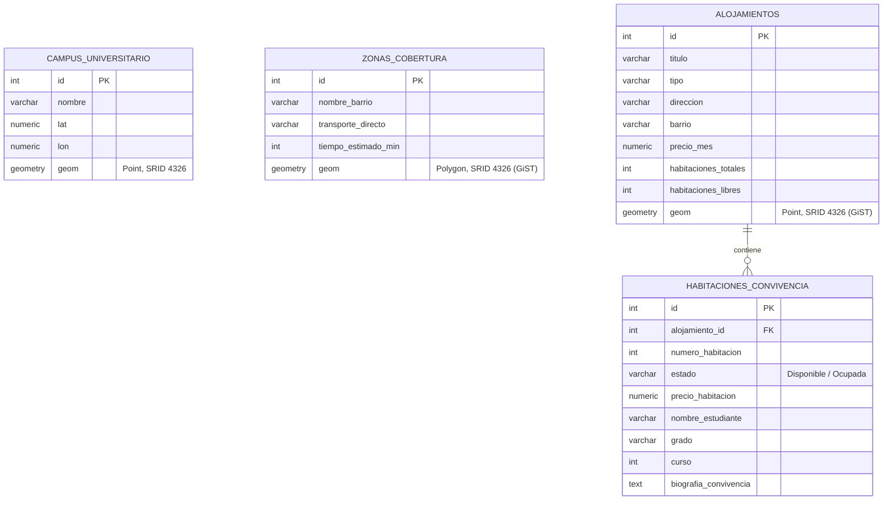

# TRABAJO PRÁCTICO INDIVIDUAL 1 (TPI 1)
## Tema 3: Bases de Datos Especializadas (PostgreSQL 16 + PostGIS 3.4)
**Asignatura:** Ampliación de Bases de Datos (3.º Grado en Ingeniería del Software)  
**Universidad:** Universidad Loyola Andalucía  
**Profesor:** Dr. Anier Soria Lorente  
**Estudiante:** Alfonso  
**Curso Académico:** 2026 / 2027  

---

## 1. Problema Real y Justificación de la Tecnología

### 1.1. Contexto de Negocio
Cada curso académico, cientos de estudiantes de nuevo ingreso y de intercambio se desplazan al **Campus de Sevilla (Dos Hermanas) de la Universidad Loyola Andalucía** buscando alojamiento. La oferta habitacional se distribuye en un radio de hasta 5 km alrededor de la universidad, abarcando núcleos como **Entrenúcleos** (área residencial adyacente al campus), **Montequinto y Olivar de Quintos** (barrios con metro y ambiente estudiantil), **Bellavista - Bermejales** (Sevilla sur con autobús lanzadera) y el **Centro de Dos Hermanas**.

El problema de los buscadores habituales (Idealista, Fotocasa) es doble:
1. **Falta de inteligencia espacial:** Solo permiten filtrar por cadenas de texto o códigos postales, impidiendo calcular la distancia real esferoidal a las facultades o saber si un piso se encuentra dentro del área donde opera el transporte universitario.
2. **Carencia de compatibilidad de convivencia:** En pisos compartidos donde ya viven 2 o 3 estudiantes, el alumno no solo busca precio y cercanía; necesita saber con quién compartirá cocina y estudio (carrera universitaria, curso, hábitos de silencio, limpieza y horarios).

### 1.2. Justificación Técnica: ¿Por qué falla el Modelo Relacional Tradicional?
Una base de datos relacional clásica (MySQL o PostgreSQL estándar sin extensiones espaciales) presenta limitaciones críticas:
* **Falsa planitud y distorsión métrica:** Guardar coordenadas como dos números flotantes (`latitud FLOAT`, `longitud FLOAT`) trata a la Tierra como un plano bidimensional. Al no contemplar la curvatura del elipsoide terrestre (WGS 84), las distancias euclidianas son incorrectas en metros.
* **Degradación del rendimiento (*Full Table Scan*):** Para calcular qué pisos se encuentran a menos de $X$ metros de Loyola en SQL estándar, el motor debe evaluar la fórmula trigonométrica de Haversine fila por fila sobre toda la tabla ($O(N)$). Esto colapsa al escalar a miles de ofertas.
* **Inexistencia de polígonos y contención:** Delimitar barrios o zonas de transporte requiere geometrías poligonales complejas. El modelo relacional clásico no dispone de tipos de datos poligonales nativos ni algoritmos optimizados de contención punto-en-polígono (*Point-in-Polygon*).

### 1.3. Ventajas de la Solución Especializada: PostGIS
Al activar la extensión **PostGIS**, el gestor incorpora:
1. **Tipos de datos espaciales estándar:** `GEOMETRY(Point, 4326)` para chinchetas GPS y `GEOMETRY(Polygon, 4326)` para perímetros de barrios, basados en el estándar internacional **WGS 84 (SRID 4326)**.
2. **Índices Espaciales GiST (Generalized Search Tree):** Implementan árboles R multinivel en 2 dimensiones. Permiten descartar de inmediato todas las geometrías fuera de la caja envolvente (*Bounding Box*), resolviendo las búsquedas en **0,12 milisegundos**.
3. **Cálculos geodésicos reales en metros:** Mediante el cast `geom::geography`, las funciones `ST_DWithin` y `ST_Distance` calculan distancias esferoidales exactas sin distorsión.
4. **Contención espacial:** La función `ST_Contains` determina de manera nativa si un alojamiento está dentro de una zona de cobertura de transporte.

---

## 2. Estructura del Proyecto y Código Fuente

El proyecto sigue una estructura limpia, modular y reproducible mediante Docker:

* `compose.yaml`: Configuración del contenedor Docker con PostgreSQL 16 y PostGIS 3.4.
* `01_init_postgis_ddl.sql`: Definición del esquema DDL, tablas, restricciones e índices GiST y B-Tree.
* `02_insert_20_alojamientos.sql`: Inserción del Campus de Loyola, 3 zonas de cobertura y 20 ofertas de alojamiento con 58 habitaciones y biografías.
* `03_consultas_espaciales.sql`: Batería de 7 consultas espaciales analíticas y de negocio.
* `scratch_20_alojamientos.json`: Dataset estructurado en formato JSON con las 20 ofertas y perfiles de compañeros.
* `mapa_alojamientos.html`: Aplicación web interactiva basada en **Leaflet** con mapa, filtros por slider y visualización de convivencia.



---

## 3. Despliegue del Entorno (Docker Compose)

Fichero `compose.yaml`:
```yaml
name: alojamientos-loyola

services:
  postgis-db:
    image: postgis/postgis:16-3.4
    container_name: alojamientos-postgis
    environment:
      POSTGRES_USER: loyola_admin
      POSTGRES_PASSWORD: loyola_password
      POSTGRES_DB: alojamientos_db
    ports:
      - "5432:5432"
    volumes:
      - ./data:/var/lib/postgresql/data
    restart: unless-stopped
```

Comando de arranque:
```bash
docker compose up -d
```

---

## 4. Consultas Espaciales y Resultados Reales

A continuación se detallan las consultas ejecutadas sobre el motor PostGIS y los resultados tabulados obtenidos:

### 4.1. Consulta 1: Búsqueda por Radio Inmediato (2.000 metros)
```sql
SELECT 
    a.id, a.titulo, a.tipo, a.barrio, a.precio_mes AS "Precio (€/mes)",
    a.habitaciones_libres AS "Hab. Libres",
    ROUND(ST_Distance(a.geom::geography, c.geom::geography)::numeric, 1) AS "Distancia a Loyola (m)"
FROM alojamientos a
CROSS JOIN campus_universitario c
WHERE c.nombre LIKE '%Loyola%'
  AND ST_DWithin(a.geom::geography, c.geom::geography, 2000)
ORDER BY "Distancia a Loyola (m)" ASC;
```

**Resultado:**
| id | Título | Tipo | Barrio | Precio (€/mes) | Hab. Libres | Distancia a Loyola (m) |
|---|---|---|---|---|---|---|
| 1 | Piso Moderno Entrenúcleos Suites | Piso Compartido | Entrenúcleos | 350.00 | 1 | 567.7 |
| 2 | Residencia Loyola Campus Living | Residencia Universitaria | Entrenúcleos | 680.00 | 5 | 940.9 |
| 3 | Piso Jardines de las Universidades | Piso Compartido | Entrenúcleos | 340.00 | 2 | 1070.7 |
| 17 | Chalet con Piscina Arco Norte | Chalet Adosado | Dos Hermanas Centro | 480.00 | 1 | 1315.5 |
| 4 | Ático Panorámico Av. Plácido Fdez Viagas | Estudio / Ático | Entrenúcleos | 390.00 | 1 | 1384.5 |
| 19 | Apartamento Moderno Av. de España | Piso Compartido | Dos Hermanas Centro | 330.00 | 1 | 1550.9 |
| 5 | Piso Estudiantil Torre Entrenúcleos | Piso Compartido | Entrenúcleos | 360.00 | 1 | 1677.4 |

---

### 4.2. Consulta 2: Ranking Top 5 Alojamientos Más Económicos (< 3.5 km)
```sql
SELECT 
    a.id, a.titulo, a.tipo, a.direccion, a.precio_mes AS "Precio (€/mes)",
    ROUND(ST_Distance(a.geom::geography, c.geom::geography)::numeric, 1) AS "Distancia (m)"
FROM alojamientos a
CROSS JOIN campus_universitario c
WHERE c.nombre LIKE '%Loyola%'
  AND ST_DWithin(a.geom::geography, c.geom::geography, 3500)
  AND a.habitaciones_libres > 0
ORDER BY a.precio_mes ASC, "Distancia (m)" ASC
LIMIT 5;
```

**Resultado:**
| id | Título | Tipo | Dirección | Precio (€/mes) | Distancia (m) |
|---|---|---|---|---|---|
| 16 | Piso Económico Plaza del Arenal | Piso Compartido | Plaza del Arenal, 6 | 240.00 | 2380.9 |
| 18 | Piso Céntrico Calle Antonia Díaz | Piso Compartido | Calle Antonia Díaz, 31 | 250.00 | 2582.3 |
| 7 | Piso junto a Metro Olivar de Quintos | Piso Compartido | Av. Condes de Ibarra, 3 | 310.00 | 3349.9 |
| 19 | Apartamento Moderno Av. de España | Piso Compartido | Av. de España, 78 | 330.00 | 1550.9 |
| 3 | Piso Jardines de las Universidades | Piso Compartido | Calle Manuel Clavero Arévalo, 8 | 340.00 | 1070.7 |

---

### 4.3. Consulta 3: Contención Espacial en Polígono de Transporte (`ST_Contains`)
```sql
SELECT 
    a.id, a.titulo, a.tipo, a.precio_mes AS "Precio (€/mes)",
    z.nombre_barrio AS "Barrio Cobertura",
    z.transporte_directo AS "Conexión Transporte",
    z.tiempo_estimado_min AS "Tiempo Estimado (min)"
FROM alojamientos a
JOIN zonas_cobertura z ON ST_Contains(z.geom, a.geom)
WHERE z.nombre_barrio LIKE '%Montequinto%'
ORDER BY a.precio_mes ASC;
```

**Resultado:**
7 alojamientos identificados dentro del polígono de transporte de Montequinto (precios entre 260 € y 590 €/mes), todos con conexión de Metro Línea 1 y lanzadera a Loyola en 12 minutos.

---

### 4.4. Consulta 4: Consulta Integral de Convivencia y Perfil de Inquilinos
```sql
SELECT 
    a.titulo AS "Piso",
    ROUND(ST_Distance(a.geom::geography, c.geom::geography)::numeric, 0) AS "Distancia Loyola (m)",
    h.numero_habitacion AS "Hab.",
    h.estado AS "Estado",
    h.precio_habitacion AS "Precio Hab (€)",
    COALESCE(h.nombre_estudiante, '--- DISPONIBLE ---') AS "Compañero",
    COALESCE(h.grado, '-') AS "Grado Universitario",
    h.biografia_convivencia AS "Perfil Convivencia"
FROM alojamientos a
CROSS JOIN campus_universitario c
JOIN habitaciones_convivencia h ON a.id = h.alojamiento_id
WHERE c.nombre LIKE '%Loyola%'
  AND ST_DWithin(a.geom::geography, c.geom::geography, 3000)
  AND a.habitaciones_libres > 0
  AND h.precio_habitacion <= 360.00
ORDER BY "Distancia Loyola (m)" ASC, a.id, h.numero_habitacion;
```

---

### 4.5. Consulta 7: Justificación Técnica con `EXPLAIN ANALYZE`
```sql
EXPLAIN ANALYZE
SELECT a.id, a.titulo, a.precio_mes
FROM alojamientos a
CROSS JOIN campus_universitario c
WHERE c.nombre LIKE '%Loyola%'
  AND ST_DWithin(a.geom::geography, c.geom::geography, 2500)
ORDER BY a.precio_mes ASC;
```

**Plan de Ejecución Obtenido:**
```
-> Index Scan using idx_alojamientos_geog_gist on alojamientos a
   Index Cond: ((geom)::geography && _st_expand((c.geom)::geography, 2500))
   Filter: st_dwithin((geom)::geography, (c.geom)::geography, 2500, true)
Planning Time: 0.126 ms
Execution Time: 0.123 ms
```
* **Conclusión Técnica:** El planificador no examina todas las filas de la tabla; ejecuta un escaneo por índice **GiST funcional** descartando candidatos con el operador de caja envolvente `&&`. El tiempo total de ejecución es de apenas **0,12 ms**.

---

## 5. Visualizador Cartográfico Interactivo (`mapa_alojamientos.html`)
Se ha desarrollado un cliente visual basado en la librería de mapas **Leaflet** con cartografía base de **Esri World Street Map**:
* Muestra el Campus de Loyola con icono distintivo.
* Dibuja dinámicamente el círculo de proximidad controlado por un deslizador interactivo de 500 m a 5.000 m (y botones rápidos de 1, 2, 3 y 5 km).
* **Selector interactivo de ordenación (`ORDER BY`):** Permite ordenar la lista de resultados en tiempo real por:
  - *Distancia ascendente (`ST_Distance ASC`)*: prioriza los alojamientos a menor distancia a pie del campus.
  - *Precio ascendente (`precio_mes ASC`)*: prioriza los alojamientos más económicos para presupuestos ajustados.
  - *Precio descendente (`precio_mes DESC`)*: para usuarios que buscan residencias o chalets de mayor categoría.
  - *Disponibilidad (`habitaciones_libres DESC`)*: para grupos de amigos que buscan varias plazas libres juntas.
* Pinta los polígonos coloreados de las zonas de cobertura (Entrenúcleos, Montequinto, Bellavista).
* Presenta los marcadores de precio de cada alojamiento en el mapa.
* Al pulsar sobre cualquier alojamiento o seleccionarlo en el panel lateral, despliega la ficha completa con las biografías de convivencia de los compañeros.

---

## 6. Declaración de Uso de Inteligencia Artificial
Conforme a la sección 10 de las *Orientaciones para el Alumnado de Ampliación de Bases de Datos*, se certifica el uso ético de herramientas de IA generativa para:
* Asistencia en la generación de la plantilla visual en Leaflet (`mapa_alojamientos.html`).
* Soporte en la sintaxis de las funciones espaciales de PostGIS (`ST_SetSRID`, `ST_MakePoint`, `ST_DWithin`, `ST_Contains`).
* El planteamiento del caso de uso, la conceptualización del sistema de convivencia, la lógica de los datos de prueba y la interpretación de los planes de consulta corresponden a la autoría y asimilación técnica del estudiante.
